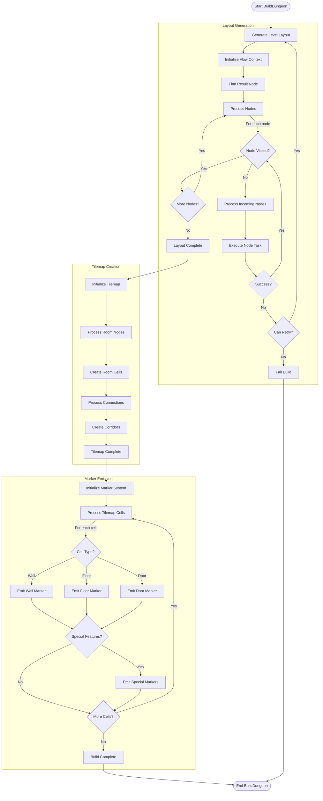
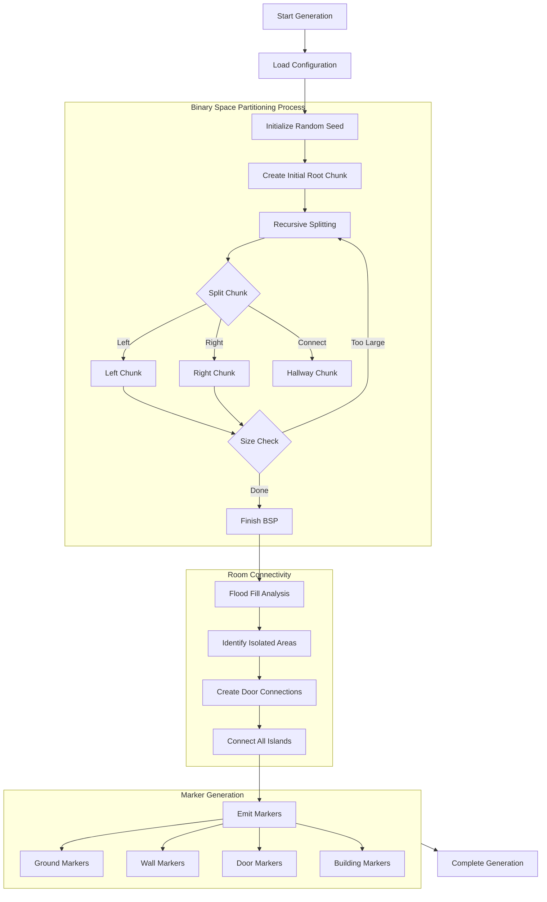

# ideas

## Flow Generator

## BSP generator

The process works in these layers:

1. **Layout Generation**
    - Uses BSP to create the initial room chunks
    - Refines the spaces and adds hallways
    - Creates door connections between rooms
    - Converts the abstract layout into a tilemap representation

2. **Marker System**
    - Places different types of markers:
        - Basic markers (Ground, Walls, Doors)
        - Special markers (Locked doors, Custom elements)
        - Overlay markers (for height variations, etc.)

    - Each marker contains:
        - Position
        - Rotation
        - Type information
        - Additional metadata

3. **Geometry Generation**
    - The markers are used as instructions for placing actual geometry
    - Each marker type corresponds to specific geometry or game objects
    - The system can handle:
        - Different wall types (full tile or edge-based)
        - Special cases (one-way doors, locked doors)
        - Height variations
        - Custom elements

This layered approach makes the system very flexible because:

- The layout generation is separate from the actual geometry
- Different themes/styles can be applied using the same markers
- Custom elements can be added without changing the core generation
- The marker system acts as a middle layer between abstract layout and final geometry

Would you like me to elaborate on any of these layers or specific aspects?
